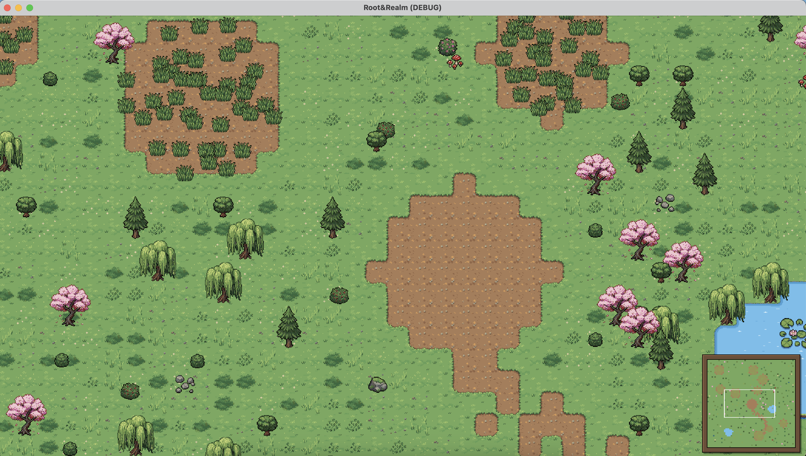

# Root & Realm

A small 2D top-down settlement builder in a procedurally generated landscape.
The world generation, rendering, camera, game time, and building placement are
in place; the economy and workers are still to come. See
[`design.md`](design.md) for the design and [`todo.md`](todo.md) for the current
plan.



The art is the [Cozy World Kit](https://vibeforge.itch.io) (32 px top-down
village & nature set, free edition); see [Licensing](#licensing).

## Running

Open `project.godot` in Godot 4.7 or newer and press F5.

From the repository root:

```sh
godot --headless --path "root&realm" --quit-after 300
```

Quote the project folder in the shell: `&` is a control operator and would
otherwise start a background job.

## Controls

- W/A/S/D or arrow keys — pan the camera
- cursor in a screen margin — pan the camera toward that edge
- click or drag the minimap (bottom-right) — move the camera there
- `=` / `-` — zoom in / out in whole steps (1×–4×, starts at 2×)
- `Space` — pause and resume
- `1` / `2` / `4` — game speed (or click the buttons on the clock strip)
- `B` — cycle the building to place; left click places it, `Esc` or right click
  cancels
- middle-drag — pan the camera

The camera is clamped to the map, so it cannot pan into the void. Mouse-wheel
zoom is not implemented yet.

## Time

`scripts/game_clock.gd` owns the calendar, and it is the real one: a 365-day
year of twelve months at their true lengths, and seasons as the three months
people mean by them (March–May spring, June–August summer, September–November
autumn, December–February winter). There are no leap years — a fixed year length
keeps the maths exact — so the world opens on 1 January of year 1, in winter.

One integer tick is 15 game minutes (96 per day). At 1× a day takes 20 real
seconds, so a season is about half an hour and a year about two hours; 4× brings
a year into a sitting.

Everything larger is derived from the tick, so a saved tick restores time
exactly, and growth can later be a function of a tree's age rather than a
running timer. Seasons exist in the calendar but nothing reacts to them yet.

`scripts/clock_hud.gd` draws the strip in the bottom-left: the calendar line and
the speed buttons. Time is read-only apart from speed — a simulation is not
scrubbable, so there is no playhead to drag.

The clock's speed also retimes the world's own animation: the water glints step
`WorldRenderer.GLINT_FRAME_MS / speed` and freeze while paused, so nothing moves
when time is stopped.

## Building placement

`scripts/building_defs.gd` is the roster as data: footprint, allowed ground, site
rule and stand-in texture per building. Four buildings exist — camp, house,
woodcutter's hut and farm — because rules for a quarry would be guesses until
stone is real.

`scripts/placement.gd` answers `can_place(world, building_id, tile) -> Reason`, so
a refusal is a reason ("something is in the way", "no mature trees in reach")
rather than a bool. Every tile of the footprint is checked and indexed, not just
its anchor, so nothing overlaps; a woodcutter wants five mature trees within six
tiles and a farm eight tilled-soil tiles within four. That radius is the only
place the map touches the economy, so it is where the rules live.

`B` arms a building and `scripts/placement_ghost.gd` draws it pale under the
cursor: the kit prop at partial alpha, its footprint tinted green or red, and the
reason printed under the frame when red. Left click commits and stays armed for
the next one; `Esc` or right click cancels. Nothing costs anything yet — prices
arrive with the inventory — and the stand-ins are kit props (`tent`, `market
stall`, `chopped log pile`, `farm cart`).

## Structure

- `scenes/levels/main.tscn` — main scene; camera and world setup live here.
- `scenes/tree.tscn` — tree entity (growth stage + species data).
- `scripts/` — one script per scene plus the world pipeline:
  `world_grid.gd` (terrain, grass variants, plot and object data),
  `world_generator.gd` (terrain painting and placement rules), and
  `world_renderer.gd` (fill layer, dual-grid blend layers, glints, y-sorted
  props).
- Every world object carries a stable `id`. `WorldGrid.objects_by_id` and
  `objects_by_tile` address it, and `WorldRenderer.object_nodes` maps it to the
  spawned node, so `remove_object(id)` deletes data and visual together.
  Clicking is a sprite-rect hit test (`WorldRenderer.pick(point)`); decor props
  deliberately have no `Area2D` or collision shape.
- `scripts/clock_hud.gd` / `scripts/game_clock.gd` — the HUD clock strip and the
  calendar it reads (see [Time](#time)).
- `scripts/building_defs.gd` / `scripts/placement.gd` / `scripts/placement_ghost.gd`
  — the building roster as data, the placement rule (`can_place` returning a
  reason) and the pale preview (see [Building placement](#building-placement)).
- `scripts/ui_frame.gd` — the wooden HUD panel both the minimap and the clock
  strip draw, so they match.
- `scripts/minimap.gd` — a HUD `Control` on a `CanvasLayer`: one image pixel per
  tile (2 px per tile on screen) in a wooden frame, plus a live rect for the
  camera view; click or drag it to move the camera. Terrain colours are sampled
  from the kit art, trees get their canopy colour (cherries read pink), and
  smaller objects tint their tile, so planted fields and scattered props show. It
  is built from `WorldGrid`, not a second viewport, so `refresh()` is the one
  call needed after the world changes.
- `addons/cozy_world_kit/` — the kit's `DualGridLayer` and `WaterGlints` nodes.
- `assets/cozy_world_kit/` — terrain atlases + their JSON corner maps, tilesets,
  props, palette and the kit's license.
- `tests/` — headless tests, one file per theme, with `_test_case.gd` as the
  shared harness (see [Tests](#tests)).
- `COZY_KIT_MIGRATION.md` — why the world looks the way it does, and what was
  removed.

## World generation

- The ground has three terrains: `grass`, `soil` and `water`. Grass is the base;
  soil is painted as the starting camp clearing, dirt trails and tilled field
  plots; water is painted as one to three ponds.
- Water always keeps a one-tile **grass bank**: the free kit has no soil ↔ water
  corner set, so two blend sets must never meet. Generation enforces the bank,
  which also reads as a natural shore.
- Trees grow only on grass, denser where the moisture noise is high, with a
  spacing rule so 64 px canopies keep a gap. Mature trees are one of four kit
  species (oak, pine, cherry, willow); seedlings and young trees use the kit's
  bush and small oak art, and stumps use the stump prop.
- Field plots are planted as whole units: a centre on grass clear of water, a
  disc of 2.6–4.2 tiles turned into tilled soil, and a light tuft scatter
  thinning towards the rim. A plot thinner than 10 tufts is dropped entirely,
  ground included. Plots keep a gap from each other and never reach into the
  starting clearing.
- Every plot is recorded in `world.patches`, and each of its tufts carries the
  plot index, its tile and an offset within that tile, so the plot can later be
  claimed, worked, or harvested as one thing.
- Low-density props (bushes, flowers, mushrooms, rocks) decorate the meadow;
  ponds get lily pads, reeds and the occasional rowboat on open water.
- A starting clearing is kept free, and a grove plus a field are guaranteed
  within reach of the start.

## Ground rendering

The ground is tile-based, not a shader:

- A `TileMapLayer` paints the 16-variant grass fill chosen by
  `WorldGrid.ground_variant`, so the base never has a visible repeat seam.
- Soil and water each get a hidden paint layer (`TileMapLayer`) with one cell per
  tile plus a `DualGridLayer` that draws the kit's 16 corner tiles from
  `terrain/atlas/grass_dirt.json` / `grass_water.json`.
- The display layer only draws blended corners (`llll`, pure grass, is skipped),
  so the fill shows through. Water glints are drawn at runtime by
  `WaterGlints` over open water.
- Blend tiles are opaque and sit half a tile up-left, so they replace whole
  16×16 quadrants of the four grass tiles around them. Grass within one tile of
  soil or water therefore uses `BLEND_EDGE_VARIANT` (fill column 0), which is
  the atlases' own grass tile pixel for pixel: no seam, and no baked decoration
  sliced in half or quarters.

Adding a new blend set later (the paid kit has 15 more) means shipping its atlas
PNG/JSON and tileset and pointing the renderer at it; no code rewrite.

### Generation tuning

The world look is tuned in `scripts/world_generator.gd`.

| Constant | Default | Effect |
|---|---|---|
| `POND_COUNT_MIN` / `POND_COUNT_MAX` | `1` / `3` | how many ponds a map gets |
| `POND_RADIUS_MIN` / `POND_RADIUS_MAX` | `2.6` / `5.0` | pond size, in tiles |
| `POND_EDGE_WOBBLE` | `0.9` | how ragged a pond outline is |
| `TRAIL_LENGTH_MIN` / `TRAIL_LENGTH_MAX` | `14` / `28` | dirt trail length |
| `TREE_DENSITY_MIN` / `TREE_DENSITY_MAX` | `0.01` / `0.22` | tree density at the dry / wet end of the moisture noise |
| `FIELD_CHANCE` | `0.006` | per-tile chance to start a plot |
| `FIELD_RADIUS_MIN` / `FIELD_RADIUS_MAX` | `2.6` / `4.2` | plot size, in tiles |
| `FIELD_TUFTS_PER_TILE` | `1.2` | tuft scatter on a plot |
| `DECOR_CHANCE` | `0.018` | meadow prop density |
| `BLEND_EDGE_VARIANT` | `0` | fill used where a blend tile can cut the grass |

## Tests

Each theme has its own headless test file, sharing `tests/_test_case.gd`:

```sh
for test in "root&realm"/tests/test_*.gd; do
  godot --headless --path "root&realm" --script "res://tests/$(basename "$test")"
done
```

Or one at a time, e.g. `--script res://tests/test_minimap.gd`. Every test exits
non-zero on failure.

| File | Covers |
|---|---|
| `test_world_generation.gd` | same-seed determinism, object ids and the id/tile indexes |
| `test_world_layout.gd` | grass/soil/water balance, water banks, forest stages, field plots |
| `test_renderer.gd` | grass fill, dual-grid corners, glints, spawned sprites, rebuild |
| `test_picking.gd` | id → node map, rect picking, object removal |
| `test_camera.gd` | zoom, edge scroll, map clamping, `focus_on` |
| `test_minimap.gd` | minimap pixels, ground/canopy/prop colours, frame, view rect, click-to-move, refresh |
| `test_clock.gd` | calendar maths, tick accumulation, pause/speed, clock strip layout and clicks |
| `test_placement.gd` | footprints, ground rules, clearance, site radii, the ghost and commit |

## Notes

- The world is 64×64 tiles of 32 px; the camera starts at 2× in the middle of
  the starting clearing.
- Generation is deterministic: `WORLD_SEED` in `scripts/main.gd` fixes the map.
- Commit a PNG's `.import` file together with the PNG.
- `preview/` holds screenshots from the migration's visual pass.

## Licensing

The Cozy World Kit assets are licensed for personal and commercial use in games
and apps, but may not be resold or redistributed as standalone assets or inside
another asset pack, and may not be used to train AI models. The full license is
in [`assets/cozy_world_kit/LICENSE.txt`](assets/cozy_world_kit/LICENSE.txt).
All kit pixels were generated with PixelLab's tools (see that file's AI
disclosure).
